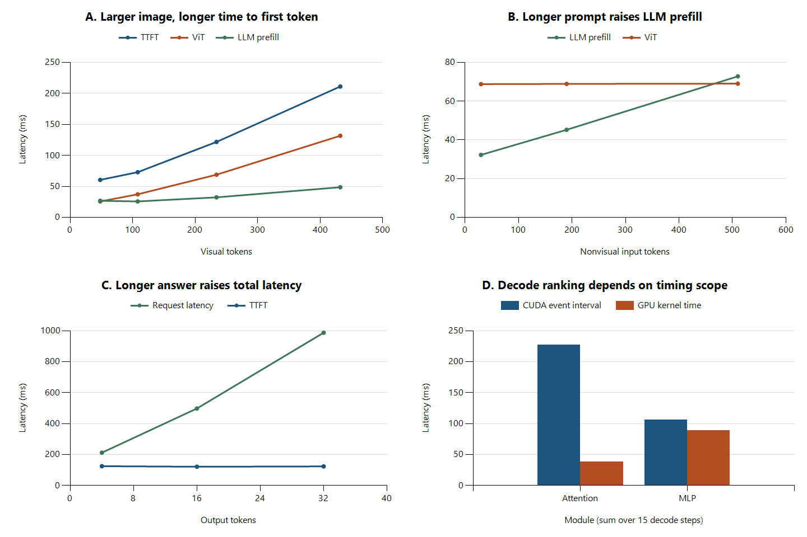

# Qwen2-VL 三层时延分析

给 Qwen2-VL 一张图片和一句提示词，模型要多久才会给出第一个 Token？如果要等整段回答生成完，又要多久？这两个时间受不同因素影响。本轮在一张 RTX 3070 上改变图像大小、输入文本长度和回答长度，观察每种变化会让哪里变慢。

**先看实验结论。** 图像越大，等待首个 Token 的时间增加得越明显，其中视觉编码的增幅最大。图像不变时，更长的输入文本主要增加语言模型的 Prefill 耗时。输入不变时，更长的回答主要增加后续逐 Token 生成的耗时，首个 Token 的等待时间变化很小。

图 A–C 使用 GPU 5 的首轮阶段数据。图 D 使用 GPU 1 的同卡短期 Decode 中位数。两组实验的设置和数据来源见下文。

## 怎么读这份报告

模型处理一个图文请求时，CPU 先把图片和文字整理成模型能接收的输入。视觉编码器（ViT）把图片变成一组视觉 Token。语言模型把这些视觉 Token 和文本一起处理，这一步叫 **Prefill**，随后选出首个输出 Token。模型再用 **Decode** 逐个生成剩下的 Token。比如回答一共 16 个 Token，本实验会记录首轮前向和后续 15 次 Decode 前向。

三层分析沿着这条流程逐步往下看。

1. **阶段级（Level 1）**回答整个请求中哪一步最花时间，例如是视觉编码慢，还是逐 Token 生成慢。
2. **模块级（Level 2）**进入某个阶段，查看模型的各层主要耗时在哪些子模块，例如 Attention（注意力）、MLP（前馈网络）和 Norm（归一化）。
3. **算子与 Kernel 级（Level 3）**查看子模块调了哪些 PyTorch 算子，以及这些算子触发了哪些实际在 GPU 上执行的程序。这样的 GPU 程序叫 CUDA Kernel。一个算子可以启动多个 Kernel。

## Level 1 哪个阶段在变慢？

本轮以 500×375 图像、短提示词和 16 个输出 Token 为参考，分别改变图像大小、输入文本长度或输出长度，一共得到 8 组实验。各尺寸都来自同一张 4:3 合成图，长文本通过重复同一句话得到。每组先预热 2 次，再打乱各组的测量顺序，共测量 7 轮。表中的时间均为中位数，单位是毫秒。非视觉输入 Token 包括文本、对话模板和特殊标记。

**TTFT** 是从 CPU 开始处理输入到 GPU 生成并确认首个 Token 的时间。**请求总耗时** 从同一起点算到模型生成结束。这两个指标都在本机测量，网络传输和界面显示在计时范围外。TTFT 括号里的 IQR 是四分位距，表示中间一半观测值的跨度，数值越大说明这组测量越分散。

表中的 ViT 包含视觉 Token 的合并。Prefill 主干只计语言模型主干的计算，输入嵌入、视觉特征融合和生成首个 Token 前的输出层计算在这个区间之外。各阶段的计时边界不同，不能直接相加得到请求总耗时。

| 实验条件 | 视觉 / 非视觉 / 输出 Token | CPU 图像预处理 | ViT | LLM Prefill 主干 | TTFT（IQR） | Decode 前向累计 | 请求总耗时 |
| --- | ---: | ---: | ---: | ---: | ---: | ---: | ---: |
| 224×168 | 48 / 30 / 16 | 1.99 | 25.65 | 26.77 | 60.44（13.75） | 399.29 | 474.37 |
| 336×252 | 108 / 30 / 16 | 3.69 | 37.15 | 25.68 | 72.87（7.67） | 383.24 | 473.50 |
| 500×375，参考组 | 234 / 30 / 16 | 10.85 | 68.80 | 32.26 | 121.69（2.97） | 369.45 | 497.56 |
| 672×504 | 432 / 30 / 16 | 17.20 | 131.63 | 48.59 | 211.18（4.00） | 369.65 | 586.56 |
| 参考图，输入增加 16 句 | 234 / 190 / 16 | 10.86 | 68.91 | 45.21 | 137.01（2.21） | 368.09 | 512.68 |
| 参考图，输入增加 48 句 | 234 / 510 / 16 | 10.99 | 69.06 | 72.82 | 169.58（1.96） | 364.39 | 540.94 |
| 参考输入，输出 4 个 Token | 234 / 30 / 4 | 12.46 | 69.67 | 32.48 | 125.02（1.34） | 85.99 | 212.22 |
| 参考输入，输出 32 个 Token | 234 / 30 / 32 | 13.33 | 68.92 | 32.34 | 123.59（4.18） | 844.46 | 986.80 |

- **图像变大。** 视觉 Token 从 48 个增至 432 个，TTFT 从 60.44 ms 增至 211.18 ms。CPU 图像预处理、ViT 和 Prefill 都有增长，其中 ViT 多用了约 106 ms，增幅最大。小图的测量波动更大，仅凭这四个尺寸还无法确定时延随分辨率增长的规律。
- **输入文本变长。** 图像固定为 500×375，模型输入总长从 264 个 Token 增至 744 个。LLM Prefill 从 32.26 ms 增至 72.82 ms，ViT 仍在 69 ms 左右。这给出了一个清楚的对照：图像处理成本基本相同，更多时间花在语言模型处理输入上。
- **输出回答变长。** 输入固定时，输出 4 个和 32 个 Token 的 TTFT 都在 122–125 ms 左右。后续 Decode 从 3 步增加到 31 步，请求总耗时也从约 212 ms 增至 987 ms。要改善用户等到首个 Token 的体验，应先看 ViT 和 Prefill。要缩短整段回答的生成时间，还要看 Decode。

最长文本组的 PyTorch 峰值分配显存中位数约为 4471 MiB，是本轮最高值。[阶段数据 CSV](campaign.dGcY90WE/stages.csv)

## Level 2 阶段内部，时间主要花在哪些模块？

每组做 3 次模块计时，并与同轮的 3 次阶段计时交替进行。这里测的是 GPU 执行流上从模块开始到结束的时间。这段时间也可能包含 CPU 尚未提交下一项 GPU 工作的间隙。整层（Block）的时间已经包含其子模块，读表时不要重复相加。加入模块计时后，生成总耗时的中位数是阶段对照的 1.09–1.49 倍，因此这组数值主要用来找值得进一步检查的模块。

| 比较对象 | 模块 | 耗时变化 |
| --- | --- | ---: |
| ViT，小图到大图 | Attention | 17.87 → 80.76 ms |
| ViT，小图到大图 | MLP | 9.26 → 44.16 ms |
| LLM Prefill，参考文本到最长文本 | Attention | 6.81 → 13.47 ms |
| LLM Prefill，参考文本到最长文本 | MLP | 23.04 → 52.06 ms |

大图增加的视觉编码时间，主要出现在 ViT 的 Attention 和 MLP。语言模型处理更长文本时，Attention 和 MLP 都变慢，其中 **MLP 的耗时增量更大**。

Decode 要按步比较，因为不同回答的步数不同。参考组把所有 LLM 层加起来，Attention 约为 14.47 ms/步，MLP 约为 6.96 ms/步。长输出组的结果也接近，分别为 14.53 和 6.98 ms/步。这个结果指出了一个值得追问的问题：Attention 模块的开始到结束间隔更长，GPU 实际执行 Kernel 的时间也更多吗？[模块数据 CSV](campaign.dGcY90WE/modules.csv) · [逐层原始数据](../results/campaign.dGcY90WE/modules.json)

## Level 3 GPU 实际在做什么？

为了看清 GPU 上执行了哪些操作，从 8 组中选出小图、参考图、大图和最长文本 4 组，每组用 PyTorch Profiler 记录 2 条 CPU/CUDA 轨迹。每条轨迹只生成 5 个 Token，覆盖首轮计算和 4 次 Decode。下表把每条轨迹中某类算子触发的实际计算 Kernel 时长加起来，再对两条轨迹取平均。单位仍为毫秒。

| 实际执行的计算 | 小图 | 参考图 | 大图 | 最长文本 |
| --- | ---: | ---: | ---: | ---: |
| ViT 矩阵乘加 `aten::addmm` | 10.95 | 36.84 | 61.45 | 36.90 |
| ViT 注意力前向 `aten::_efficient_attention_forward` | 1.16 | 13.89 | 41.35 | 13.91 |
| LLM Prefill 矩阵乘 `aten::mm` | 10.79 | 25.79 | 37.59 | 56.70 |
| LLM Decode 矩阵乘 `aten::mm`（4 步） | 29.39 | 29.55 | 29.55 | 29.41 |

- **为什么大图的 ViT 更慢？** 从小图到大图，矩阵乘加从 10.95 ms 增至 61.45 ms，注意力前向从 1.16 ms 增至 41.35 ms。轨迹中可以找到 FP16 矩阵乘 Kernel 和融合注意力 Kernel。这和模块级观察一致：图像变大后，线性投影、MLP 和注意力计算都值得关注。
- **为什么长文本的 Prefill 更慢？** 参考组到最长文本组，Prefill 的矩阵乘从 25.79 ms 增至 56.70 ms。按模块标签查看，MLP 触发的 Kernel 从 25.50 ms 增至 57.63 ms。这说明在本次输入长度范围内，新增的 Prefill 计算主要落在 MLP 的矩阵乘上。
- **为什么 Decode 的两层排名不同？** 在参考组的 4 步 Decode 中，MLP 触发的计算 Kernel 共用 23.67 ms，Attention 共用 10.32 ms，输出层（LM head）和 Norm 分别用了 4.31 和 2.96 ms。模块级测的是从进入模块到离开模块的整个时间，Kernel 级只累计 GPU 实际执行的计算。提交间隙、同步和探针都有可能影响模块计时，本轮还没有量化它们各占多少。轨迹也没有硬件性能计数器，因此目前无法判断这些 Kernel 是否受显存带宽或算力上限限制。

早期预实验把视觉配置中的 `eager` 当成了实际注意力实现。本次用相同配置重新加载后，确认视觉模块实际是 `VisionSdpaAttention`，语言模型是 `Qwen2VLSdpaAttention`，与轨迹中看到的 SDPA 路径相符。复现实验时应同时记录配置字段和实际模块类。[算子数据 CSV](campaign.dGcY90WE/operators.csv) · [Kernel 数据 CSV](campaign.dGcY90WE/kernels.csv) · [轨迹覆盖率 CSV](campaign.dGcY90WE/trace_coverage.csv)

## 实验条件与结果适用范围

实验于 2026-11-19 在实验服务器的 RTX 3070 GPU 5 上完成。模型为 Qwen2-VL-2B-Instruct，版本提交为 `895c3a49bc3fa70a340399125c650a463535e71c`。使用单卡 FP16、每次一个请求、贪心生成，以及单次请求内的 KV Cache。软件版本为 PyTorch 2.7.1+cu126、Transformers 4.51.3 和 NVIDIA 驱动 570.211.01。

本轮共记录 62,666 次 Kernel 调用，均可关联到轨迹中的阶段或外围工作。结果目录提供逐次样本、脚本及输入的哈希和 GPU 快照。8 条压缩轨迹和运行日志保留在本地。汇总时检查了控制变量、输出长度、Token ID 一致性、模块调用次数和计时边界。[复现命令](../docs/run_latency_campaign.md) · [原始结果目录](../results/campaign.dGcY90WE/)

这些数字反映的是本轮合成输入、模型和 GPU 环境。服务器是共享机器，实验只记录了每部分开始和结束时的 GPU 状态。四张真实图像与两个短期会话的复测结果见下文。与 VLMCache 的手机 CPU 实验对比时，可以讨论瓶颈分布，但要说明硬件、运行环境和输入的差异。

## 补充实验一 Decode 的两种计时为什么排序不同

在 RTX 3070 GPU 1 上固定 500×375 参考图、264 个输入 Token 和 16 个输出 Token，比较完全相同的 15 个 Decode 步。每种轻量测法各跑 7 次，轮换顺序。对照请求只记录整段生成的时间，模块探针用 CUDA Event 记录 Attention 和 MLP 区间，另一种测法只加 NVTX 标记。预热和输入传输在计时范围外。所有参考组的输出 Token ID 已核对一致。

| 采集内容 | 生成耗时中位数 | 相对对照 |
| --- | ---: | ---: |
| 原生生成对照 | 494.85 ms | 1.000× |
| 只加 NVTX 标记 | 515.86 ms | 1.042× |
| 加 CUDA Event 模块探针 | 562.58 ms | 1.137× |

CUDA Event 研究中，Attention 模块从进入到离开的时间累计中位数为 **229.47 ms**，MLP 为 **105.50 ms**。独立采集的两条 PyTorch Profiler 轨迹中，Attention 的实际计算 Kernel 约 **37.89–38.88 ms**，MLP 约 **88.60–88.92 ms**。两种工具使用了相同的输入和 Decode 步数。这里记录整段生成时长与累计模块时间，各自统计边界不同。

Nsight Systems 又在同一个参考条件下采了两条 CUDA/NVTX 轨迹。分析通过 CUDA 关联 ID 把设备活动接回 CPU API，再用 NVTX 标签定位具体层和 Decode 步。每条参考轨迹都关联了 23,063 个 Kernel。

| 15 步中所有对应模块的时间和 | Attention | MLP |
| --- | ---: | ---: |
| 计算 Kernel 直接执行 | 37.73 ms | 88.47–88.48 ms |
| 模块第一个 GPU 活动开始到最后一个结束的区间内，无已记录 GPU 活动的时间 | 223.58–224.18 ms | 1.51–1.54 ms |
| 其中下一次关联 CUDA API 尚未进入的空档 | 162.40–163.61 ms | 0–0.01 ms |
| CPU 停留在启动 Kernel 的 API 内 | 55.72–56.75 ms | 14.47–15.10 ms |

这说明，在采集到的时间线上，Attention 虽然计算 Kernel 执行得更短，但 GPU 工作之间的空档多得多。约 73% 的 Attention 空档发生在主机进入下一次相关 CUDA API 之前。两条参考轨迹的 Attention 和 MLP 范围内均未记录到被统计的 CUDA 同步或阻塞复制 API。在相邻前向步骤之间，两条轨迹各记录到 45 个这类 API 事件，CPU 区间累计约 5.50–5.56 ms。这部分是整段请求的步间时间，不能记到 Attention 或 MLP 名下。

PyTorch 轨迹也看到了 Attention 空档更大，但“两次提交之间有多少空档”的估计在两条 PyTorch 轨迹之间波动更大。报告因此采用两条一致的 Nsight Systems 参考轨迹描述其规模。CPU API 时间与 GPU 空档可重叠，表中各行不能相加。证据支持“主机下一次提交尚未发生时，Attention 的 GPU 时间线已经出现空档”。至于时间具体花在 Python、框架准备、线程调度还是采集开销上，本次时间线没有分开测量，采集条件下的绝对空档也不能直接套到原生生成上。

[对照计时](../results/decode-study.dxcl0wAl/kineto-tables/benchmark_summary.csv) · [PyTorch 时间线汇总](../results/decode-study.dxcl0wAl/kineto-tables/decode_timeline.csv) · [Nsight Systems 时间线汇总](../results/decode-study.dxcl0wAl/nsys-tables/decode_timeline.csv)

## 补充实验二 三个热点 Kernel 的硬件计数

服务器原先没有找到已安装的 Nsight CLI。使用 NVIDIA 官方归档，在个人项目目录内配置并实测了 Nsight Systems 2024.6.2.225 和 Nsight Compute 2025.1.1。Nsight Systems 采了两条参考图轨迹和一条大图轨迹。Nsight Compute 获得了三个目标 Kernel 的计数，每个目标只采一个匹配的启动。计数器采集会多次重放这次启动。SM 吞吐表示流式多处理器的吞吐计数，DRAM 吞吐反映显存读写，实际占用率反映活跃 warp 数相对上限。

| 被测 Kernel | 时长 | DRAM 吞吐 | SM 吞吐 | 实际占用率 |
| --- | ---: | ---: | ---: | ---: |
| Decode 第 14 号 LLM 层 MLP 的 `gemv2T_kernel_val` | 72 µs | 90.74% | 32.83% | 63.60% |
| 同一 Decode 步 Attention 的 CUTLASS GEMM | 18.08 µs | 72.30% | 9.47% | 9.05% |
| 大图第 15 号 ViT 层的融合注意力 `fmha_cutlassF` | 1.14 ms | 16.60% | 20.63% | 16.66% |

表中的层号从 0 开始。MLP GEMV 的显存吞吐达到本次计数器口径下的较高水平，计算吞吐低得多，支持这个 Kernel 实例受显存传输限制。Attention GEMM 并行占用很低，同时有较高的 DRAM 吞吐。大图 FMHA 的 DRAM 和 SM 吞吐均较低，计数器显示它受每块共享内存使用量限制，每个 SM 至多驻留 1 个 Block。

补采调度计数时，Attention GEMM 的调度器有 **92.33%** 的周期找不到可发射指令的 warp，平均每个调度器只有 **0.08** 个符合条件的 warp。大图 FMHA 对应为 **78.85%** 和 **0.30**。结合共享内存和占用率，说明两个实例都经常没有足够的就绪工作可发射。目前还不能把这些等待细分到具体指令依赖或内存访问延迟。上述结论针对采到的 Kernel 和输入范围，原生推理时长以对照为准。

[MLP GEMV 计数](../results/decode-study.dxcl0wAl/decode-mlp-gemv.ncu.csv) · [Attention GEMM 计数](../results/decode-study.dxcl0wAl/decode-attention-gemm.ncu.csv) · [ViT FMHA 计数](../results/decode-study.dxcl0wAl/vision-fmha.ncu.csv) · [Attention GEMM 调度](../results/decode-study.dxcl0wAl/decode-attention-gemm-stalls.ncu.csv) · [ViT FMHA 调度](../results/decode-study.dxcl0wAl/vision-fmha-stalls.ncu.csv) · [复现命令](../docs/run_latency_campaign.md)

## 补充实验三 短期重复性和 Attention 空档细分

在 GPU 1 上对同一个参考请求做 3 组独立重复。每组在新进程中预热，再做 5 次 CUDA Event 请求和 1 次粗粒度 Nsight Systems 采集。各组都固定为 500×375、264 个输入 Token、16 个输出 Token 和 15 次 Decode。模型版本、输入哈希和输出 Token ID 已核对。

| 组别 | Attention Event 中位数 / P90（ms/请求） | MLP Event 中位数 / P90（ms/请求） | Attention Kernel 累计（ms/轨迹） | MLP Kernel 累计（ms/轨迹） |
| --- | ---: | ---: | ---: | ---: |
| 1 | 228.57 / 229.69 | 105.71 / 105.92 | 37.79 | 88.46 |
| 2 | 224.62 / 226.23 | 105.54 / 105.67 | 37.95 | 88.51 |
| 3 | 232.64 / 233.93 | 106.15 / 107.37 | 38.94 | 88.85 |
| 合并 | 227.07 / 233.06 | 105.71 / 106.23 | 37.95（中位数） | 88.51（中位数） |

**同卡短期内，两种排序都稳定。** 15 次 Event 请求里 Attention 均比 MLP 长，3 条 Nsight 轨迹里 MLP 的实际 Kernel 累计均比 Attention 长。合并后的 Event 请求 IQR 为 Attention 3.86 ms、MLP 0.48 ms。把三个轨迹里的 45 个 Decode 步合并，Kernel 每步中位数 / P90 为 Attention 2.53 / 2.63 ms、MLP 5.90 / 5.93 ms。每步样本来自相同轨迹，不能视为 45 次独立运行。每组只有一条轨迹，因此单组的整轨迹 Kernel 累计只报告一次观测。

运行过程记录了 GPU 索引和 UUID、温度、频率、显存及其他计算进程数。GPU 1 有本实验计算进程的采样点中，温度为 33–49°C，三个组的 SM 时钟中位数为 1950–1965 MHz，卡上显存使用量峰值为 5019 MiB。采样未发现其他 GPU 计算进程。三个粗粒度轨迹中，Attention 空档在下一次相关 CUDA API 开始前就已出现的比例为 72.69%–76.02%，但空档总量为 219–304 ms，明显比实际 Kernel 时间更容易受采集和主机状态影响。

跨 GPU 一致性验证已按用户决定取消。这里的排序和尾部时延统计限于 GPU 1 的三组短期测量。

### 空档出现时，主机在做什么

另采一条带有 Attention 内部 NVTX 子标记的 Nsight Systems 时间线。它使用同一组输入和输出长度，输出 Token ID 与粗粒度测量一致，单独用于定位来源。这些标记只包住已有投影、RoPE 位置编码、KV Cache 更新、KV 头扩展和 SDPA 调用。

在 420 次 Decode Attention 模块调用中，分析得到 **252.73 ms** 的模块内部 GPU 空档。按下一次相关 CUDA API 的开始、结束对齐，**192.04 ms** 在 API 开始前，**48.40 ms** 与 API 内部重合，**12.29 ms** 在 API 返回之后。API 开始前的空档中，与 RoPE 的 CPU 区间重合最多，为 **73.64 ms**。其次是 KV 头扩展 **24.10 ms**、Q/K/V 投影 **19.07 ms** 和 SDPA **17.37 ms**。另有 **35.76 ms** 落在已标注子区间之外。这个划分来自 CPU 和 GPU 时间轴重叠，无法进一步判定每一段中 Python、运行时、线程调度分别消耗多少时间。新增 NVTX 标记也会改变观测时长。

[同卡统计 CSV](decode_repeats/decode_statistics.csv) · [排序检查](decode_repeats/decode_rankings.csv) · [GPU 遥测汇总](decode_repeats/gpu_environment.csv) · [细分空档数据](../results/attention-detail.gpu1.o7xtq2Sy/tables/attention_gap_breakdown.csv)

## A/B 复测与验收

A/B 都在 GPU 1 上完成。两次各跑 8 组合成图和 20 组真实图，共 392 次正式测量。合成图和四张真实图的 ViT 时延中位数在两个会话中都随四个尺寸逐级增加。真实图从最小到最大尺寸增加约 103–109 ms。固定图像时，长文本带来的 Prefill 增量约 39–40 ms。输出从 4 增至 32 个 Token 时，两次会话的完整请求都明显变长，TTFT 约为 123–125 ms。[A/B 原始数据与逐图对照](../docs/run_reproduction.md) · [趋势汇总 CSV](reproduction/reproduction_comparisons.csv)

### 仍存在的问题

1. **绝对时延比趋势更容易变。** 同一张卡上，合成小图的 TTFT 四分位距从 A 的 1.43 ms 到 B 的 12.33 ms。B 的样本分为快慢两段，ViT 和 Prefill 一起变化。四张真实小图的组内波动不大，但这四张图的中位数在 B 也比 A 更快。遥测间隔约 2 秒，只能提供运行背景，无法解释毫秒级变化。
2. **Attention 的 CPU 空档还有未分解部分。** 时间线已经定位到下一次 CUDA API 提交前的空档，并看到其中与 RoPE 等子操作重合的区间。Python、框架内部工作和线程调度的具体贡献仍未知。计时插桩也增加了耗时，因此不把采集轨迹的绝对空档当成原生端到端结果。
3. **硬件归因只覆盖选中的 Kernel。** 例如 Decode MLP 的 GEMV 实例显示高 DRAM 吞吐，大图 ViT 的融合注意力实例受到共享内存和低并行占用限制。硬件计数使用重放，同一个 Kernel 名也可能对应不同输入形状，结论要附上被测层、输入和计数条件。
4. **实验范围有限。** 真实图只有四张，控制了尺寸和 Token 预算。短期 Decode 的 P90 是少量分组样本的描述。当前证据支持原生 Qwen2-VL-2B 在单张 RTX 3070、FP16、batch 1 的瓶颈分析。跨卡和长期稳定性没有独立验证。

本轮计划内的采集、核验、图表与报告已完成。以上限制决定结论的表述范围，不影响当前三层实验的验收。[研究计划与验收状态](../docs/research_plan.md)
